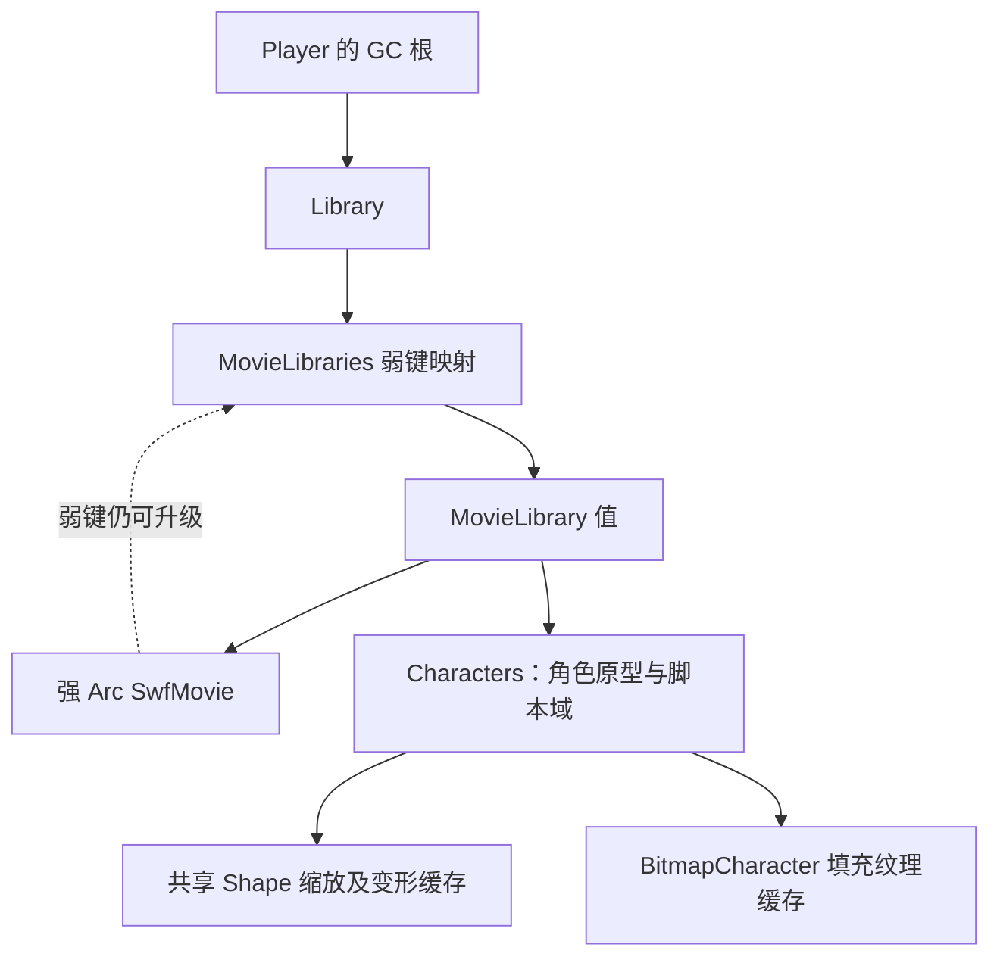

# 资源持有与缓存释放排查（2026-10-21）

## 已确认并修复

### 静态 Shape 预加载和首次绘制重复分配

原实现的 `Graphic::from_swf_tag` 在 SWF 预加载期间调用 `register_shape`，
将基础网格保存在共享的 `render_handle` 中。首次实际绘制时，
`get_or_retessellate_handle` 的缩放缓存为空，又调用 `register_shape_with_scale`。
正常绘制使用缩放缓存，基础网格仍随角色库长期保留；未绘制的角色也已创建网格。
以位图填充的网格还可能提前触发 BitmapCharacter 的解码/上传。

修改删除该基础网格预分配，仅在真正绘制时生成所需缩放网格，继续复用原有的
每角色 4 项缩放 LRU。路径、命中几何、角色定义和脚本类继续保留。
首次绘制可能承担原先预加载阶段的细分开销。

### MorphShape 所有比例永久缓存

原 `MorphShapeShared.frames` 对遇到的比例保留插值几何、GPU ShapeHandle 和
九宫格渐变缓存，最多可能覆盖一个角色的全部 65,536 个比例。
修改为每个共享变形角色保留最近使用的 64 个比例。淘汰会释放该帧的缓存引用；
正在使用同一 ShapeHandle 的绘制命令通过自身引用继续保持资源有效。
被淘汰的比例按原比例重新计算，未量化比例或降低精度。命中测试也通过该重建入口
取几何，避免结果依赖缓存是否命中。

64 是每角色的缓存项上限，不是全局字节预算。复杂帧仍可能较大，超过该工作集的
动画或多个实例同时使用许多比例时可能增加重建开销。尚不能据此认定真实游戏的
主要内存消耗来自变形缓存。

## 仍存在的持有链

映射的键虽然是 Weak，值的 `MovieLibrary.swf` 自身强持有同一个 movie；
`MovieLibraries::trace` 又无条件跟踪其中的角色库。角色原型、SWF 切片和脚本域
也参与持有，不能靠把单个字段改为 Weak 解决。`LoaderInfo::unload` 脱离显示内容，
不会直接移除对应 MovieLibrary；离开舞台不等于脚本再也无法使用该角色或类。

本轮没有直接删除 MovieLibrary、脚本可见 BitmapData 或类映射。
上游本地可见提交 `e22a464a5acf591c1295636264dd4a769c422a5e` 将 SwfMovie 迁移到 GC，
提交说明明确称其是后续解决 movie 泄漏的前置工作，弱映射版本原本也有泄漏。
这仍需要完整的对象可达性设计和加载/卸载兼容性验证。

其余路径检查结果：

- 静态缩放缓存已有每角色 4 项 LRU，九宫格渐变缓存已有每缓存 32 项 LRU；
  两者都是局部数量上限，不能约束所有已加载角色的总字节数。
- BitmapCharacter 的填充纹理由 OnceCell 长期保留；本次延迟细分减少了未绘制角色
  提前触发它的机会，尚未给已使用填充纹理增加淘汰。
- 显示对象脱离容器时，现有代码会递归清理可重建的 cacheAsBitmap 纹理；
  Drawing.clear 也会丢弃 ShapeHandle 和渐变缓存。这些路径未发现本次需要重复补的遗漏。
- 临时纹理池 128 MiB 是闲置保留上限，不能覆盖使用中的、在途的或角色库持有的资源。

新增日志统计 `library_graphics`、`untessellated_graphics`、`graphic_mesh_refs`、
`morph_symbols`、`morph_frames`、`morph_mesh_refs`、`bitmap_fill_refs`。
它们统计角色库引用，导入/共享角色可能重复计数，不等同于唯一 GPU 分配数量；
不含动态 Drawing、字体和九宫格渐变变体。后端弱句柄统计提供实际存活网格数及
顶点/索引缓冲估算，亦不包含全部驱动/在途分配。

## 验证

- 新增 2 项缓存释放测试通过：淘汰后缓存引用释放、外部绘制引用安全、最近使用项保留、
  被淘汰项可重新构建。
- 现有显示对象子树脱离容器后立即释放位图缓存的测试通过。
- 43 项现有回归通过：变形/命中 8、九宫格 2、静态几何 14、混合/遮罩 19。
- Android arm64 release 构建成功，更新独立诊断包并保留应用数据。

同一手机、同一 2× MSAA 设置，在前一诊断 APK 和本次 APK 中运行相同 SWF：

| 场景 | 修复前存活网格 | 修复后存活网格 | 画面 |
| --- | ---: | ---: | --- |
| 定义 1,000 个 Shape，只显示 1 个 | 1,001 | 1 | 2800×1280 RGB 逐像素一致 |
| 遍历 131 个变形比例，再返回首个比例并停止 | 131 | 64 | 2800×1280 RGB 逐像素一致 |

静态场景日志显示 1,000 个角色定义中 999 个未细分，仅持有 1 个缩放网格。
变形场景显示 `morph_frames=64 morph_mesh_refs=64`，证明旧帧句柄已经释放。
固定场景的几何较小，进程 RSS 有系统噪声，不用其 RSS 推断真实游戏节省百分比。

固定场景源生成脚本、SWF、截图和日志保存在
`.local/device-tests/{make-preload-shape-stress,make-morph-cache-stress,run-resource-cache-tests}.py`
及 `.local/device-results-resource-cache/{baseline,optimized}/`。
像素比较结果在 `.local/device-results-resource-cache/image-comparison.json`。

APK：`build/diagnostics/ruffle-resource-cache-arm64-diagnostic.apk`
SHA-256：`fee2be7de5c6a26402e7d384bef6024b363ee1fa467f66a447536715e49ca1d8`
包名：`rs.ruffle.kabu.diagnostics`（游戏不卡（诊断））。
匹配的本机符号文件：`build/diagnostics/resource-cache-symbols/libruffle_android.so`。

核心开发分支仍为 `codex/local-blend-filter-resolution`；尚未合并到 `0.7.1-A`。

## 剩余原生分配采样

本版在正常游玩期间额外采样 20 秒，采样间隔 1 MiB、共享缓冲 32 MiB，
使用上面匹配的符号文件离线解析。轨迹有 2,096 条分配记录，未出现共享缓冲溢出、
丢包或未完成 profile；存在 1 个空调用栈记录，已被工具忽略。
净正值较大的采样栈落在 SWF 加载/解析、ShapeRecord 数组扩容、MovieClip 实例化、
AVM2 执行和 BitmapData 初始化，也有正常的瞬时分配。
这些数据只覆盖采样窗口内分配，不覆盖之前已存活的对象；净正值不能单独证明泄漏，
也不能把分配总流量当作常驻量。采样窗口会扰动帧耗时，本轮不是受控性能 A/B。

原始轨迹与符号化调用栈：
`.local/device-results-resource-cache/gameplay/native-heap.perfetto-trace`、
`native-heap-live-stacks.json`、`native-heap-live-stacks.txt`。

后续对象生命周期工作应跟踪 Loader / ApplicationDomain / 类映射的真实可达性，
并验证卸载后仍被脚本引用的类、导入角色、定时器和监听器仍能正常工作。
当前 `unloadAndStop` 代码还明确保留了定时器和事件监听器清理未实现的说明。
不能用删除所有离开舞台的 MovieLibrary、清空脚本可见 BitmapData，或周期性清空
所有缓存代替这部分生命周期设计。

## 新版正常游玩五分钟

用户重新进入游戏后，PID 20975 连续运行 300 秒，11 次采样均处于 PlayerActivity。
监测日志和结束后追加拉取的日志均未发现 panic / OutOfMemory；游戏保持打开。
所有采样实际为 2× MSAA，SWF 请求 High，前端上限 Medium。

| 秒 | RSS (MiB) | Swap (MiB) | 已知 SWF | Shape 顶点/索引 (MiB) | 上传位图估算 (MiB) |
| --- | ---: | ---: | ---: | ---: | ---: |
| 0 | 1065.4 | 20.3 | 179 | 31.9 | 47.9 |
| 30 | 1050.6 | 14.2 | 179 | 31.9 | 48.3 |
| 60 | 1294.8 | 14.2 | 223 | 37.3 | 60.7 |
| 90 | 1263.2 | 14.2 | 260 | 42.1 | 66.5 |
| 120 | 1202.2 | 234.0 | 420 | 64.2 | 72.3 |
| 150 | 1285.2 | 178.6 | 493 | 69.8 | 77.5 |
| 180 | 1433.8 | 177.1 | 531 | 73.2 | 87.7 |
| 210 | 1497.7 | 176.5 | 542 | 92.0 | 112.9 |
| 240 | 1396.1 | 285.5 | 596 | 110.9 | 114.1 |
| 270 | 1541.3 | 318.8 | 679 | 129.8 | 137.1 |
| 300 | 1395.1 | 520.2 | 736 | 138.2 | 142.8 |

末尾角色库包含 17,647 个静态 Shape，其中 13,065 个未细分，静态网格引用 5,290；
220 个变形角色合计缓存 397 帧，其中 360 帧有网格。实际存活网格共 6,890，
其顶点/索引缓冲约 138.2 MiB（还包括字体、动态绘制等其他来源）。
GC 对象计数从约 120 万增至 273 万，期间有回落；原始 SWF payload 从
32.8 增至 64.1 MiB，角色定义从 9,441 增至 34,697。
最后采样的进程 RSS 1395.1 MiB，Swap 520.2 MiB；RSS 历史峰值为 1589.6 MiB。
低 RSS 可能包含换出影响，不能据此断言内存总占用下降。

前一版本另一次五分钟游玩末尾网格为 423.9 MiB，本轮为 138.2 MiB；
两次加载内容、动作和采样时点不同，因此只作为观察数据，不计算受控 A/B 节省率。
能够严格对比的是前面的相同 SWF 固定场景。

结论：静态 Shape 提前/重复分配已被消除，变形缓存淘汰已验证；真实游戏中大量
未绘制 Shape 也确实没有创建 GPU 网格。但 SWF/角色库和其他原生资源仍累积，
本轮五分钟无 OOM 不代表长期 OOM 已修复。MovieLibrary / ApplicationDomain / 类
与对象可达性仍是下一层排查重点。未合并到 `0.7.1-A`。

本轮完整采样记录：`.local/device-results-resource-cache/gameplay/monitor.json`；
结束后日志：`perf-final.log`。此前版本继续运行的最后现场已保存到
`.local/device-results-resource-cache/baseline-live/perf.log`，其中也未检测到 OOM，
但 Shape 缓冲已达约 486 MiB、Swap 超过 1 GiB。
